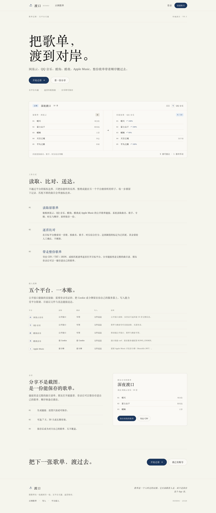
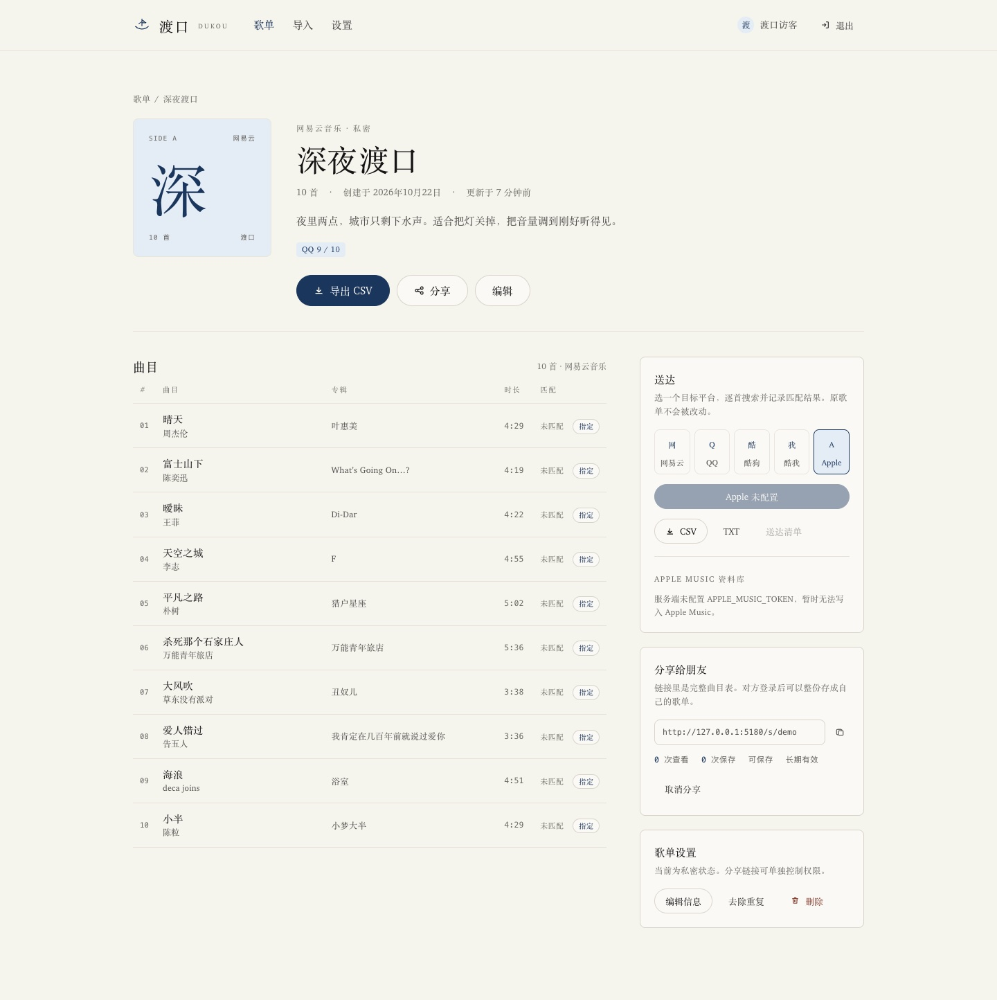
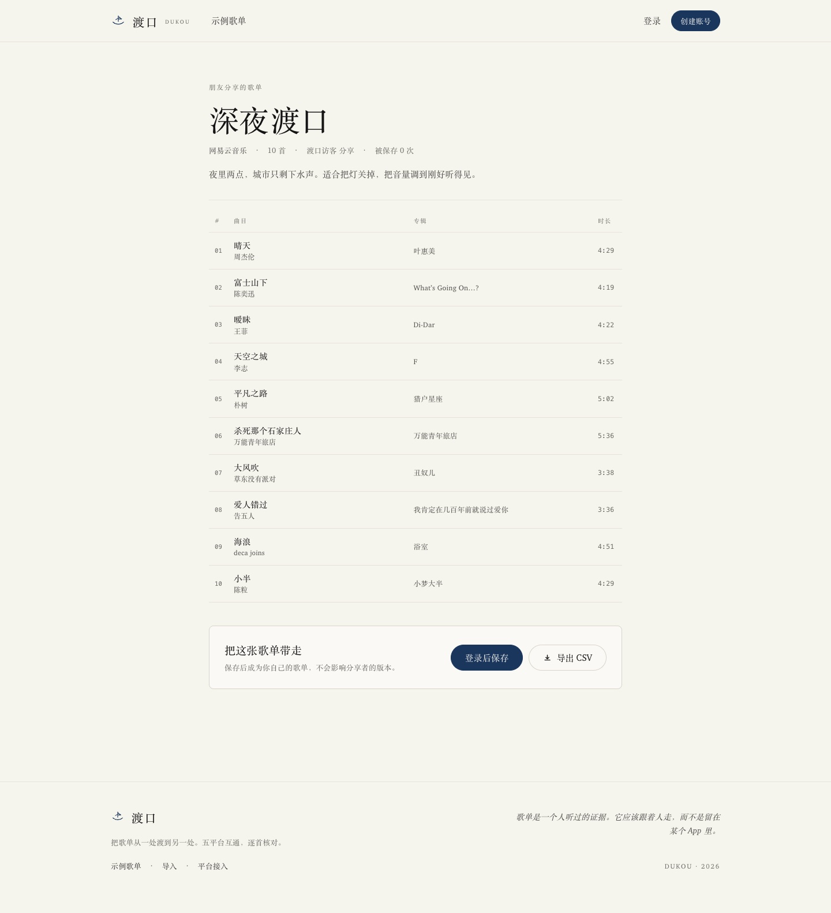
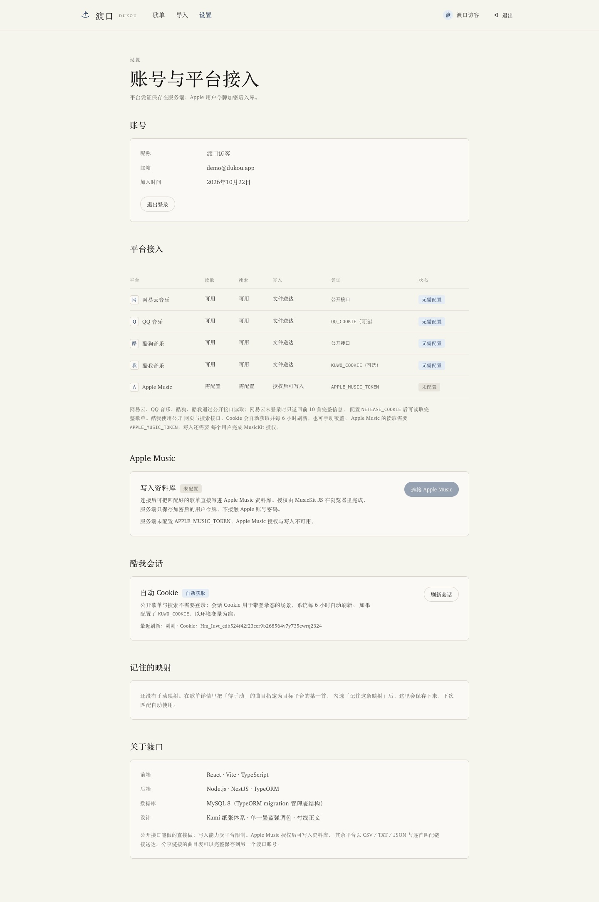
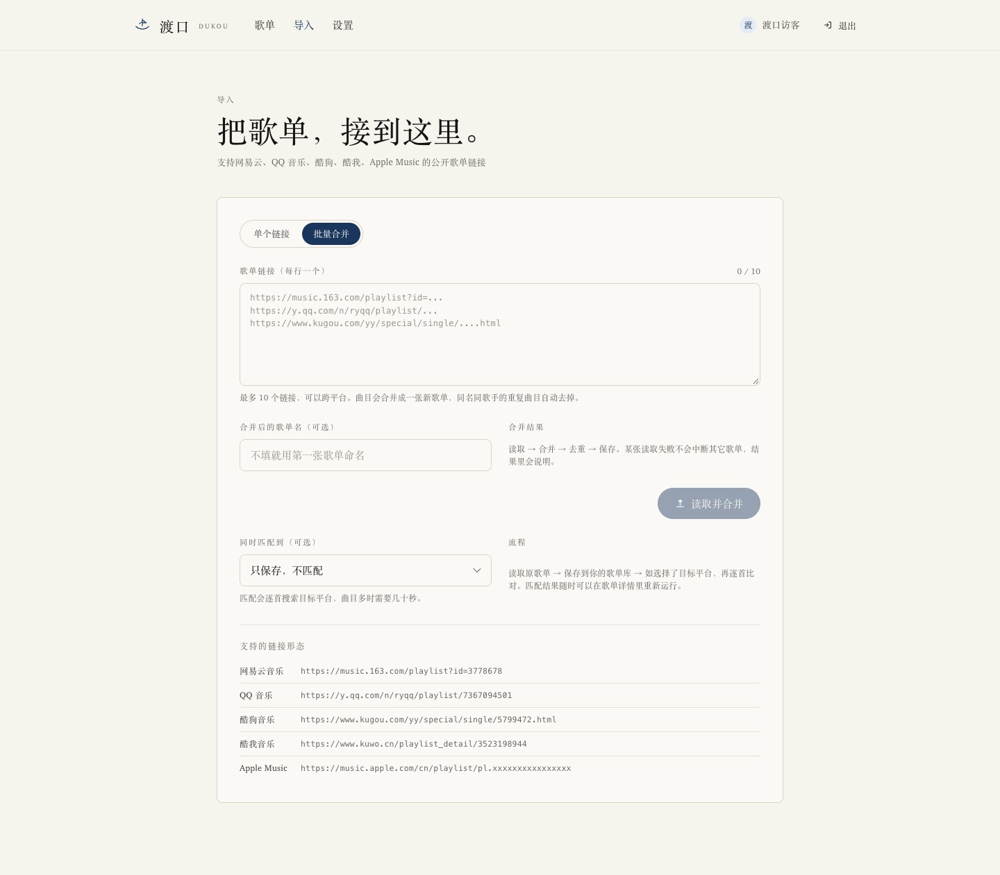

# 渡口 · Dukou

> 把歌单，渡到对岸。

渡口是一个跨平台歌单迁移与分享网站：读取公开歌单，逐首匹配到目标平台，合并去重，导出可迁移的文件，并把歌单变成朋友可以一键保存的分享链接。

**网易云音乐 · QQ 音乐 · 酷狗音乐 · 酷我音乐 · Apple Music**



## 功能

- **单张 / 批量导入**：粘贴链接或分享口令，自动识别平台；一次最多 10 个链接，可跨平台合并成一张歌单，并自动去除同名同歌手重复曲目。
- **逐首匹配 + 人工校正**：按曲名 / 歌手 / 时长综合打分；匹配不准的曲目可以搜索目标平台并手动「指定为这首」，可记住映射，下次自动使用。
- **歌单合并 / 去重**：把已有歌单合并成新歌单；任意歌单可一键去除重复曲目。
- **送达清单**：已匹配曲目直达目标平台，未匹配曲目给出搜索页；CSV / TXT / JSON 导出，带 UTF-8 BOM。
- **Apple Music 写入**：用户在设置里完成 MusicKit 授权后，可把匹配好的歌单直接写进 Apple Music 资料库。
- **朋友分享**：只读 / 可保存两种分享权限，7 天 / 30 天 / 长期有效，记录查看与保存次数；对方登录后整份克隆成自己的歌单。
- **酷我会话**：自动从公开站点获取会话 Cookie，每 6 小时刷新；可用 `KUWO_COOKIE` 覆盖。
- **账号体系**：邮箱注册 / 登录，bcrypt 加盐哈希，JWT 鉴权；平台令牌 AES-256-GCM 加密后入库。





## 平台支持

公开接口能做的直接做；不能做的，不假装能做。

| 平台 | 读取 | 搜索 | 写入 | 凭证 | 当前状态 |
| --- | --- | --- | --- | --- | --- |
| 网易云音乐 | 公开接口 | 可用 | 文件送达 | `NETEASE_COOKIE`（可选） | **已实测**；匿名接口只返回前 10 首完整信息 |
| QQ 音乐 | 公开接口 | 可用 | 文件送达 | `QQ_COOKIE`（可选） | **已实测**；歌单与搜索无需登录 |
| 酷狗音乐 | 公开接口 | 可用 | 文件送达 | 无 | **已实测**；移动端接口，实测 37 首歌单 |
| 酷我音乐 | 公开接口 | 可用 | 文件送达 | `KUWO_COOKIE`（可选） | **已实测**；SSR 页面 + 搜索接口，无需登录 |
| Apple Music | 需开发者令牌 | 需令牌 | **可写资料库** | `APPLE_MUSIC_TOKEN` + 用户 MusicKit 授权 | 接口已完成；本机无开发者令牌，授权/写入未实测 |

**关于「写入」**：

- Apple Music 通过 MusicKit 用户授权，调用 `/v1/me/library/playlists` 创建资料库歌单，属于真实写入。
- 其余四个平台没有面向个人的公开歌单写入 API。渡口的交付是：匹配清单（直达链接 / 搜索链接）、CSV / TXT / JSON 文件、以及可保存到另一个渡口账号的分享链接。网易云 / QQ 音乐 / 酷狗的文本桥与本机扩展方案见 [docs/写入方案.md](docs/写入方案.md)。

## 技术栈与结构

| 层 | 选择 |
| --- | --- |
| 前端 | React 19 · Vite 7 · TypeScript · React Router 7 · TanStack Query 5 |
| 后端 | Node.js · NestJS 11 · TypeORM 0.3 |
| 数据库 | **MySQL 8**，表结构完全由 TypeORM migration 管理，`synchronize` 永远关闭 |
| 测试 | Node.js test runner（单元 + Nest e2e）· Playwright（UI）· GitHub Actions |
| 设计 | Kami 纸张体系：羊皮纸底色、单一墨蓝强调色、衬线正文、发丝线表格 |

```
apps/web  (React + Vite)
   │  /api 由 Vite 代理（生产由 nginx 反代）
apps/api  (NestJS)
   ├── MySQL 8（docker-compose 提供）
   ├── TypeORM migrations（启动前显式执行）
   └── Platform adapters: netease / qq / kugou / kuwo / apple
```

## 快速开始

要求：Node.js ≥ 20，pnpm ≥ 9，Docker Desktop（或本机 MySQL 8）。

```bash
pnpm install
cp .env.example apps/api/.env

# 启动 MySQL（首次会创建 dukou 与 dukou_test 两个库）
docker compose up -d

# 建表（TypeORM migration）
pnpm --filter @dukou/api db:migrate

# 演示数据：3 张歌单、26 首曲目、分享 /s/demo
pnpm seed

# 同时启动 API 与 Web
pnpm dev
```

打开：

- 网站：<http://localhost:5173>（端口被占用时 Vite 会自动顺延，以终端输出为准）
- API：<http://localhost:3000/api>，健康检查 `/api/health`
- 演示账号：`demo@dukou.app` / `demo1234`
- 演示分享：`/s/demo`

> `.npmrc` 指向 npmmirror，便于国内网络安装；海外环境可删除。
> Docker Hub 不可达时，可以用镜像源拉取 MySQL，例如
> `docker pull docker.m.daocloud.io/library/mysql:8.4 && docker tag docker.m.daocloud.io/library/mysql:8.4 mysql:8.4`。

### 常用脚本

| 命令 | 作用 |
| --- | --- |
| `pnpm dev` | 并行启动 API 与 Web |
| `pnpm build` | 构建前后端 |
| `pnpm typecheck` | TypeScript 检查 |
| `pnpm seed` | 写入演示账号与歌单（幂等） |
| `pnpm test` | 单元 + Nest e2e + Playwright |
| `pnpm test:unit` / `test:e2e` / `test:ui` | 分层执行测试 |
| `pnpm --filter @dukou/api start` | 运行构建后的 API |

## 数据库迁移

`synchronize` 已移除。所有表结构变更都进入 `apps/api/src/database/migrations/`。

| 命令 | 作用 |
| --- | --- |
| `pnpm --filter @dukou/api db:migrate` | 执行待处理 migration |
| `pnpm --filter @dukou/api db:reset` | 清库并重跑全部 migration（**仅测试/开发**） |
| `pnpm --filter @dukou/api db:check` | 对比实体与数据库，不一致时退出码非 0（CI 门禁） |
| `pnpm --filter @dukou/api db:revert` | 回滚最后一个 migration |
| `pnpm --filter @dukou/api db:generate AddSomething` | 根据实体差异生成新 migration |
| `pnpm --filter @dukou/api db:migrate:prod` | 对构建后的 `dist` 执行 migration |

新增字段或表的流程：

1. 修改实体；
2. 运行 `db:generate <名字>`，审查生成的 SQL（尤其是索引、外键和默认值）；
3. 在空库与现有库上分别执行 `db:migrate`；
4. 运行 `db:check`，CI 会拦截实体与 migration 不一致的提交。

生产容器启动时会先执行 `node dist/database/migrate.js up`，再启动 API。

## 关键流程

### 批量导入、合并、去重

- 导入页切换「批量合并」，每行一个链接（最多 10 个），可跨平台；曲目合并后按「归一化曲名 + 归一化歌手」去重。
- 某张歌单读取失败不会中断其它歌单，任务结果会列出失败原因。
- 首页「合并歌单」把已有歌单合成一张新歌单；详情页「去除重复」清理单张歌单。
- 匹配使用同一套归一化，全角/半角、大小写、空格与常见标点不会造成假重复。



### 人工指定与记住映射

在歌单详情选择目标平台后，未匹配曲目旁会出现「指定」：搜索目标平台，选中正确版本，勾选「记住这条映射」保存。后端把映射写入 `track_aliases`（按用户 + 平台 + 归一化曲名/歌手唯一），下次匹配同一首歌时直接命中，并在结果中标记为「记住」。设置页可以查看和删除这些映射。

### 分享

- 创建分享时可选择「可查看，也可保存」或「仅可查看」，并设置 7 / 30 天或长期有效。
- 分享页 `/s/:token` 公开可读，展示完整曲目表；登录用户可整份克隆，克隆会复制曲目顺序，但不复制匹配记录。
- 分享页也支持直接导出 CSV。

### 酷我会话

公开歌单与搜索不依赖登录。`KuwoSessionService` 会访问 `https://www.kuwo.cn/` 读取站点下发的 Cookie，缓存 6 小时；过期后自动刷新。若设置 `KUWO_COOKIE`，则以环境变量为准。可在设置页查看来源与 Cookie 名称，或手动刷新。

### Apple Music 授权

1. 在 Apple Developer 后台创建 MusicKit 标识与私钥，生成开发者 JWT（ES256，建议有效期不超过 6 个月），配置为 `APPLE_MUSIC_TOKEN`，区号配置为 `APPLE_MUSIC_STOREFRONT`。
2. 用户打开设置页 → Apple Music → 「连接 Apple Music」。前端加载 MusicKit JS，弹出 Apple 授权窗口，拿到 `musicUserToken`。
3. 后端用 `CREDENTIALS_SECRET` 派生的密钥 AES-256-GCM 加密后存入 `platform_credentials`，并用 `/v1/me/library/playlists` 校验令牌。
4. 用户在详情页匹配到 Apple Music 后，点「写入资料库」：后端创建资料库歌单并分批写入曲目（每批最多 100 首）。

未配置开发者令牌时，设置页会明确显示「未配置」，不会假装可以授权。

## API 一览

所有接口以 `/api` 为前缀；除标注「公开」外均需 `Authorization: Bearer <token>`。

| 方法 | 路径 | 说明 |
| --- | --- | --- |
| POST | `/auth/register` · `/auth/login` | 注册 / 登录 |
| GET | `/auth/me` | 当前账号 |
| GET | `/platforms` | 平台能力、凭证与会话状态 |
| POST | `/platforms/search` | 在目标平台搜索曲目 |
| POST | `/platforms/resolve` | 识别链接（含短链展开） |
| GET/POST | `/platforms/kuwo/session` · `/refresh` | 酷我会话状态 / 刷新 |
| GET | `/platforms/apple/config` | Apple 开发者令牌与授权状态 |
| POST/DELETE | `/platforms/apple/authorize` | 绑定 / 断开 MusicKit 用户令牌 |
| POST | `/platforms/apple/playlists/:id/push` | 写入 Apple Music 资料库 |
| GET/POST | `/playlists` | 歌单列表 / 新建 |
| POST | `/playlists/merge` | 合并多张歌单 |
| GET/PATCH/DELETE | `/playlists/:id` | 详情 / 编辑 / 删除 |
| POST | `/playlists/:id/dedupe` | 去除重复曲目 |
| POST | `/playlists/:id/items/:itemId/match` | 人工指定匹配 |
| POST | `/playlists/:id/match` | 逐首自动匹配 |
| GET | `/playlists/:id/delivery?platform=` | 送达清单 |
| GET | `/playlists/:id/export?format=csv\|txt\|json&platform=` | 导出文件 |
| GET/POST/DELETE | `/aliases` | 查看 / 删除记住的映射 |
| POST/GET/DELETE | `/shares` | 创建 / 列出 / 取消分享 |
| GET | `/share/:token`（公开） | 分享页数据 |
| GET | `/share/:token/export`（公开） | 分享页导出 |
| POST | `/share/:token/clone` | 保存到自己的歌单 |
| GET/POST | `/imports` · `/imports/batch` · GET `/imports/:id` | 单张 / 批量导入与进度 |
| GET | `/health`（公开） | 数据库与平台状态 |

## 数据模型

- `users` — 账号、密码哈希、昵称
- `playlists` — 歌单元信息、来源平台与链接、可见性
- `playlist_items` — 曲目快照（曲名、歌手、专辑、时长、顺序、来源）
- `track_matches` — 每首曲目在每个平台的匹配结果、分数、来源（auto / manual / alias）
- `track_aliases` — 用户级「记住的映射」
- `platform_credentials` — 加密后的平台用户令牌（当前为 Apple Music）
- `shares` — 分享 token、权限、有效期、查看 / 保存计数
- `import_jobs` — 单张 / 批量导入 URL、状态、进度、去重数、失败原因

## 设计

视觉遵循 Kami 的纸张体系：

- 页面底色 `#f5f4ed`，容器 `#faf9f5`，强调色只有墨蓝 `#1B365D`；
- 全站单一衬线字族（Charter / 宋体），标题 500、正文 400，不使用粗体与斜体（页脚题记除外）；
- 表格只保留水平发丝线，状态靠文字与单一强调色表达，不用红绿黄；
- 没有阴影、渐变、玻璃拟态和装饰性色块；
- 分享、导出、匹配、批量合并都使用同一套按钮与标签词汇。

移动端从 880 / 720 / 480 三个断点收起：侧栏面板改为单列，平台表格变为纵向清单，详情页封面移到标题上方。

## 测试

```bash
pnpm --filter @dukou/api test:unit   # 归一化、去重、相似度评分
pnpm --filter @dukou/api test:e2e    # Nest + supertest，真实 MySQL（dukou_test）
pnpm test:ui                         # Playwright，启动独立测试 API/Web（3100 / 5280）
pnpm test                            # 全部
```

- **单元测试**：`trackKey`、`dedupeTracks`、Dice 系数、匹配评分。
- **Nest e2e**：健康检查、鉴权、建歌单、去重、CSV 导出、分享与克隆、人工指定与映射、合并、批量导入校验、Apple 状态。每次运行前 `db:reset`，真实读写 MySQL。
- **Playwright**：首页、登录、批量导入切换、设置页、注册后保存分享、创建歌单。`playwright.config.ts` 会自动拉起测试 API（3100）与 Web（5280），并写入测试库 `dukou_test`。

GitHub Actions（`.github/workflows/ci.yml`）使用 MySQL 8.4 service，依次执行 migration、`db:check`、单元、e2e、构建和 Playwright。

## 生产部署

前端是 nginx 静态站点，`/api` 反代到 NestJS；数据库只在内网暴露。

```bash
cp .env.production.example .env.production
# 填写数据库密码、JWT_SECRET、CREDENTIALS_SECRET、域名
set -a; source .env.production; set +a

docker compose -f docker-compose.prod.yml --env-file .env.production up -d --build
```

- 默认入口 `http://localhost:8080`；把 `WEB_PORT` 改成 80/443 或在前置反向代理上终止 TLS。
- Docker Hub 不可达时，先拉取镜像源里的 MySQL / Node / nginx 并重新打 tag；`.env.production` 里的 `NPM_REGISTRY` 控制容器内 pnpm 的下载源。
- API 容器启动时自动执行 migration。
- `WEB_ORIGIN` 必须改成实际站点域名（含协议），否则浏览器跨域会被拒绝。
- 生产请用 `https://`，并把 `WEB_BASE_URL` 设置为同一域名，分享链接会基于它生成。
- 备份卷 `dukou-mysql-prod` 需要持久化；数据库不要映射到公网。

升级流程：

```bash
git pull
docker compose -f docker-compose.prod.yml --env-file .env.production build
docker compose -f docker-compose.prod.yml --env-file .env.production up -d
```

API 启动时会自动跑 migration；如需手动执行：`docker compose ... exec api node dist/database/migrate.js up`。

### 备份与恢复

逻辑备份（推荐，可跨 MySQL 版本恢复）：

```bash
set -a; source .env.production; set +a
MYSQL_ROOT_PASSWORD="$MYSQL_ROOT_PASSWORD" ./scripts/backup-mysql.sh
# 输出：backups/dukou-YYYYmmdd-HHMMSS.sql.gz，默认保留 14 天
```

恢复（会覆盖当前库，脚本要求输入库名确认）：

```bash
MYSQL_ROOT_PASSWORD="$MYSQL_ROOT_PASSWORD" ./scripts/restore-mysql.sh backups/dukou-20260101-030000.sql.gz
```

每日 3 点备份的 cron 示例：

```cron
0 3 * * * cd /srv/dukou && set -a && . ./.env.production && set +a && ./scripts/backup-mysql.sh >> ./backups/backup.log 2>&1
```

如果还需要整卷快照（包含 MySQL 系统表），在停机窗口执行：

```bash
docker run --rm -v dukou-mysql-prod:/data -v "$PWD/backups":/backup alpine \
  tar czf /backup/mysql-volume-$(date +%F).tar.gz -C /data .
```

恢复卷快照前先停止 api，并清空目标卷。

## 验证情况

已在 macOS + Node 24 + Docker Desktop（MySQL 8.4.13）上完成：

- 两个 TypeORM migration 从空库执行成功，`db:check` 显示 schema 与实体一致；
- 生产镜像 `dukou-api:latest` / `dukou-web:latest` 构建成功；用独立 compose 项目完整拉起 MySQL 8.4 + API（自动 migration）+ nginx，`/api/health` 返回 200，nginx 反代注册接口与 SPA 路由均正常；
- `scripts/backup-mysql.sh` 在运行中的生产栈上生成并校验了逻辑备份；
- 单元测试 6 项、Nest e2e 11 项、Playwright 6 项全部通过；
- 真实读取 QQ 音乐（30 首）、酷狗（37 首）、酷我（20 首，免 Cookie）、网易云（匿名 10/30 首并给出限制提示）；
- 手工指定匹配 → 记住映射 → 重跑匹配命中 alias；浏览器里完成一次「指定」：搜索 QQ 音乐、选中版本、行状态变为「手动 100%」；
- 批量合并两张歌单、去重、CSV 导出、分享克隆均通过；
- 浏览器端登录、批量导入切换、设置页、注册后保存分享、创建歌单均通过 Playwright。

**未验证**：

- Apple Music 的 MusicKit 授权与资料库写入：本机没有 Apple Developer 开发者令牌与订阅账号，只能验证未配置时的错误提示与配置接口；
- 真实公网域名的 TLS、域名与安全组未部署（生产 compose 与 nginx 已在本机验证）；
- Playwright 的批量导入与人工指定仍依赖外部平台网络，未纳入自动 UI 用例（人工指定已手动走通，后端 e2e 覆盖了映射接口）；
- GitHub Actions workflow 已提交，但尚未在 GitHub 上实际触发一次。

## 后续计划

- Apple Music 授权的真机联调与令牌过期提醒；
- 匹配的人工校正批量化（一次指定多首）；
- 分享链接的密码保护与访问审计；
- 对象存储封面缓存、任务队列（BullMQ）替代进程内异步；
- Playwright 覆盖批量导入与人工指定（当前依赖外部平台，放在手动验收）。

---

项目未附许可证。演示数据中的曲名、歌手仅用于界面展示。
