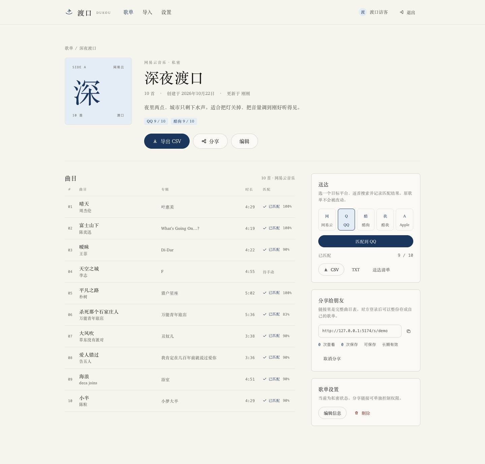

# 渡口 · Dukou

> 把歌单，渡到对岸。

渡口是一个跨平台歌单迁移与分享网站：读取公开歌单，逐首匹配到目标平台，导出可迁移的文件，并把歌单变成朋友可以一键保存的分享链接。

**网易云音乐 · QQ 音乐 · 酷狗音乐 · 酷我音乐 · Apple Music**


## 功能

- **链接导入**：粘贴分享口令或链接，自动识别平台并读取歌单（曲名、歌手、专辑、时长、顺序）。
- **逐首匹配**：在目标平台搜索同一首歌，按曲名 / 歌手 / 时长综合打分；低于阈值的曲目明确标为「待手动」，不硬凑。
- **送达清单**：已匹配曲目可直接打开目标平台，未匹配曲目给出搜索页直达链接。
- **导出**：CSV / TXT / JSON 三种格式，可附带目标平台的匹配结果；文件带 UTF-8 BOM，Excel 直接打开不乱码。
- **朋友分享**：生成只读或可保存的分享链接，支持 7 天 / 30 天 / 长期有效，记录查看与保存次数；对方登录后可整份存成自己的歌单。
- **歌单管理**：手动新建、编辑、删除，纸感封面自动生成，导入任务进度与历史可查。
- **账号体系**：邮箱注册 / 登录，bcrypt 加盐哈希，JWT 鉴权。




## 平台支持（请先读这一节）

公开接口能做的直接做；不能做的，不假装能做。

| 平台 | 读取 | 搜索 | 写入 | 凭证 | 当前状态 |
| --- | --- | --- | --- | --- | --- |
| 网易云音乐 | 公开接口 | 可用 | 生成文件 | `NETEASE_COOKIE`（可选） | **已实测**；匿名接口只返回前 10 首完整信息 |
| QQ 音乐 | 公开接口 | 可用 | 生成文件 | `QQ_COOKIE`（可选） | **已实测**；歌单与搜索均无需登录 |
| 酷狗音乐 | 公开接口 | 可用 | 生成文件 | 无 | **已实测**；移动端接口，实测 37 首歌单 |
| 酷我音乐 | 需 Cookie | 需 Cookie | 生成文件 | `KUWO_COOKIE`（含 `kw_token`） | 适配器已完成；本机无有效 Cookie，未实测 |
| Apple Music | 需开发者令牌 | 需令牌 | 生成文件 | `APPLE_MUSIC_TOKEN` | 适配器已完成；本机无 MusicKit JWT，未实测 |

**关于「写入」**：五个平台都没有面向个人的公开歌单写入 API。渡口不会用非公开接口替用户操作账号。因此「导出到目标平台」的实际交付是：

1. 匹配清单（每首曲目在目标平台的直达链接或搜索链接）；
2. CSV / TXT / JSON 文件，可交给迁移工具或手动导入；
3. 分享链接，让另一个渡口账号整份保存。

代码里的 `PlatformAdapter` 预留了 `write` 能力位；将来接入官方开放平台时，可以按平台逐个打开。

## 技术栈

| 层 | 选择 |
| --- | --- |
| 前端 | React 19 · Vite 7 · TypeScript · React Router 7 · TanStack Query 5 |
| 后端 | Node.js · NestJS 11 · TypeORM 0.3 |
| 数据库 | MySQL 8（默认）；`sql.js` 作为零安装本地演示驱动 |
| 设计 | Kami 纸张体系：羊皮纸底色、单一墨蓝强调色、衬线正文、发丝线表格、无阴影无渐变 |

```
apps/web  (React + Vite, :5173)
   │  /api 由 Vite 代理
apps/api  (NestJS, :3000/api)
   ├── MySQL 8  (DB_DRIVER=mysql)
   └── sql.js   (DB_DRIVER=sqljs，本地演示)
         └── Platform adapters: netease / qq / kugou / kuwo / apple
```

## 快速开始

要求：Node.js ≥ 20，pnpm ≥ 9；MySQL 8（可选，Docker 或本机实例均可）。

> 仓库内的 `.npmrc` 指向 npmmirror 镜像，便于国内网络安装；海外环境可以删除该文件恢复官方源。

```bash
pnpm install

# 配置后端
cp .env.example apps/api/.env

# 方案 A：MySQL（生产形态）
docker compose up -d

# 方案 B：零安装本地预览（无需 MySQL）
# 把 apps/api/.env 里的 DB_DRIVER 改成 sqljs

# 写入演示数据（3 张歌单、26 首曲目、一条分享 /s/demo）
pnpm seed

# 同时启动 API 与 Web
pnpm dev
```

打开：

- 网站：<http://localhost:5173>（若端口被占用，Vite 会自动换下一个端口，以终端输出为准）
- API：<http://localhost:3000/api>
- 健康检查：<http://localhost:3000/api/health>
- 演示分享：`/s/demo`

演示账号：

```
demo@dukou.app / demo1234
```

### 常用脚本

| 命令 | 作用 |
| --- | --- |
| `pnpm dev` | 并行启动 API 与 Web |
| `pnpm dev:api` / `pnpm dev:web` | 单独启动 |
| `pnpm build` | 构建前后端（API `tsc`，Web `vite build`） |
| `pnpm typecheck` | 两个包分别做 TypeScript 检查 |
| `pnpm seed` | 幂等写入演示账号与歌单 |
| `pnpm --filter @dukou/api start` | 运行构建后的 API |

## 环境变量

复制 `.env.example`，按需填写。关键项：

| 变量 | 默认 | 说明 |
| --- | --- | --- |
| `DB_DRIVER` | `mysql` | `mysql` 或 `sqljs`（本地演示） |
| `DB_HOST` / `DB_PORT` / `DB_USER` / `DB_PASSWORD` / `DB_NAME` | `127.0.0.1` / `3306` / `dukou` / `dukou` / `dukou` | MySQL 连接 |
| `DB_SYNCHRONIZE` | `true` | 开发期自动建表；生产建议改为 `false` 并使用迁移 |
| `JWT_SECRET` | `change-me-in-production` | **生产必须替换** |
| `WEB_ORIGIN` | `http://localhost:5173` | 允许的跨域来源，逗号分隔 |
| `WEB_BASE_URL` | `http://localhost:5173` | 生成分享链接时使用 |
| `NETEASE_COOKIE` / `QQ_COOKIE` / `KUWO_COOKIE` | 空 | 平台登录 Cookie，只存在服务端 |
| `APPLE_MUSIC_TOKEN` / `APPLE_MUSIC_STOREFRONT` | 空 / `cn` | MusicKit 开发者 JWT 与区号 |
| `PORT` | `3000` | API 端口 |

## API 一览

所有接口以 `/api` 为前缀；除标注「公开」外均需 `Authorization: Bearer <token>`。

| 方法 | 路径 | 说明 |
| --- | --- | --- |
| POST | `/auth/register` · `/auth/login` | 注册 / 登录 |
| GET | `/auth/me` | 当前账号 |
| GET | `/platforms` | 平台能力与凭证状态 |
| POST | `/platforms/resolve` | 识别链接（含短链展开） |
| GET/POST | `/playlists` | 歌单列表 / 新建 |
| GET/PATCH/DELETE | `/playlists/:id` | 详情 / 编辑 / 删除 |
| POST | `/playlists/:id/items` · DELETE `.../items/:itemId` | 增删曲目 |
| POST | `/playlists/:id/match` | 逐首匹配到目标平台 |
| GET | `/playlists/:id/delivery?platform=` | 送达清单 |
| GET | `/playlists/:id/export?format=csv\|txt\|json&platform=` | 下载迁移文件 |
| POST/GET/DELETE | `/shares` | 创建 / 列出 / 取消分享 |
| GET | `/share/:token`（公开） | 分享页数据 |
| GET | `/share/:token/export`（公开） | 分享页导出 |
| POST | `/share/:token/clone` | 保存到自己的歌单 |
| GET/POST | `/imports` · GET `/imports/:id` | 导入任务与进度 |
| GET | `/health`（公开） | 数据库与平台状态 |

## 数据模型

- `users` — 账号、密码哈希、昵称
- `playlists` — 歌单元信息、来源平台与来源链接、可见性
- `playlist_items` — 曲目快照（曲名、歌手、专辑、时长、顺序、来源）
- `track_matches` — 每首曲目在每个目标平台的匹配结果与分数（唯一约束：item + platform）
- `shares` — 分享 token、权限、有效期、查看 / 保存计数
- `import_jobs` — 导入 URL、状态、进度、失败原因

## 设计与界面

视觉遵循 Kami 的纸张体系：

- 页面底色 `#f5f4ed`，容器 `#faf9f5`，强调色只有墨蓝 `#1B365D`；
- 全站单一衬线字族（Charter / 宋体），标题 500、正文 400，不使用粗体与斜体（页脚题记除外）；
- 表格只保留水平发丝线，状态靠文字与单一强调色表达，不用红绿黄；
- 没有阴影、渐变、玻璃拟态和装饰性色块；
- 分享、导出、匹配都使用同一套按钮与标签词汇。

移动端从 880 / 720 / 480 三个断点收起：侧栏面板改为单列，平台表格变为纵向清单，详情页封面移到标题上方。

## 验证情况

已在 macOS + Node 24 上完成：

- `pnpm typecheck` 与 `pnpm build` 通过；
- 真实读取 QQ 音乐（30 首）、酷狗（37 首）、网易云（匿名 10/30 首并给出限制提示）；
- 对「深夜渡口」执行 QQ / 酷狗匹配，分别命中 9/10 首；
- CSV 导出、分享创建、匿名访问分享页、第二个账号克隆分享歌单；
- 浏览器走通登录 → 导入 → 匹配 → 分享，控制台无报错；
- 1440px 与 390px 截图逐页检查（见 `docs/screenshots/`）。

**未验证**：

- 本机没有 MySQL / Docker，运行时使用 `sql.js`。MySQL 配置是默认路径，实体字段已按 MySQL 类型书写，但尚未对真实 MySQL 实例跑过建表与查询；
- 酷我、Apple Music 的在线读取需要有效 Cookie / 开发者令牌，本机未配置，因此只验证了适配器代码与错误提示路径。

## 后续计划

- 用 TypeORM migration 替代 `synchronize`，补齐生产部署与备份说明；
- 酷我 Cookie 自动获取与刷新、Apple Music MusicKit 授权流程；
- 匹配的人工校正界面（把「待手动」改成「指定为某首」并记住映射）；
- 批量导入 / 多歌单合并、重复曲目去重；
- 集成测试（Nest e2e + Playwright）与 GitHub Actions。

---

项目未附许可证。演示数据中的曲名、歌手仅用于界面展示。
